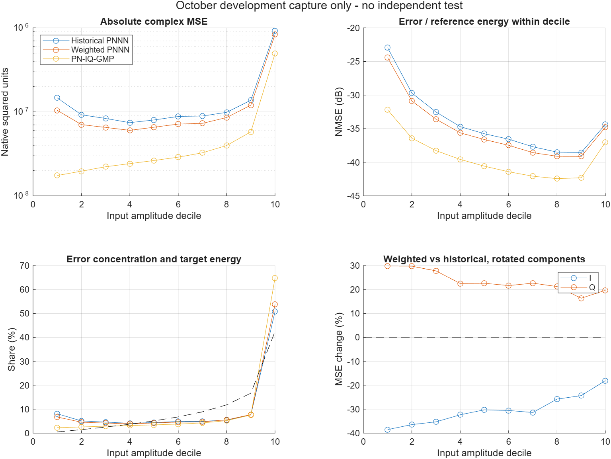

# Frozen P310 loss validation and scientific review

Date: 2026-11-04. All new work is isolated here. No training, production
changes, model changes, RF access, CFR, commits or pushes were performed.

## Decision

Retain the physical-loss PNNN as a frozen research comparator, not as an
established production replacement. Its same-capture imitation improvement
is numerically reproducible: all three reconstructed model predictions match
their saved references bit for bit. Generalization remains untested because
no eligible independent capture was found in this repository.

Investigating a small, predeclared mixed-loss experiment is reasonable because
the Q regression is systematic on the development data and has a measurable
target-tangential counterpart. First secure an untouched validation capture
and a fixed protocol. Architecture changes are not the next controlled step:
the remaining gap is substantial, but this evidence cannot distinguish
representation limits from optimization and loss effects. No mixed-loss fit
or architecture experiment was executed.

## Data inventory and independence decision

The recursive file inventory contains 458 original MAT files. All top-level
MAT schemas were inspected; 18 capture/provenance candidates were inspected
in detail. The only raw capture identities found are April 29 and October 23.
See `schema_inventory.csv`, `inventory.csv`, `completion.log`, and
`tp26258254_88b1_41bb_acbb_019da9b1d4ec/inventory.log`.

| Candidate | Available evidence | Independent-test decision |
|---|---|---|
| October `experiment20261023T102742_xy.mat`, two copies | Exact same x/y in both copies; original training/development capture | Reject: direct training/development reuse |
| April `experiment20260429T134032_xy.mat` | x=u, y=x_ILC, 491520 samples, fs=491.52 MHz; already used by two DPD sweeps and prior architecture/phase/PN-IQ analyses | Reject as untouched final test; prior development use and incomplete operating-condition provenance |
| April `experiment20260429T134032_forward_xy.mat`, two copies | PA-forward mapping, target RMS 38.5540, not the required ILC target | Reject: wrong target domain; no inversion or fitted rescaling is justified |
| October DPD measurement/execution files | Same October campaign; predictions or measured PA responses, not a new untouched u -> x_ILC pair | Reject as a new independent imitation capture |
| Sweep/acceleration/phase artifacts | Source metadata points back to April or October | Reject: derivative artifacts are not new captures |

April is distinct in acquisition date, but the raw input arrays in April and
October are **exactly equal**. Both reuse waveform seed 1000 and the same
491520-sample excitation. Their ILC targets differ by 0.1673100595 relative
L2; April target RMS is 1.1591698492 times October's. These numbers describe
the stored pairs; no gain, delay or phase was fitted to reconcile them.
Same-input recapture could test temporal operating-point repeatability if
its provenance were controlled; it is not unseen-excitation generalization.

The April ILC file lacks `exp_config`. It provides waveform metadata and
sample rate, but not sufficient saved evidence to verify the same PA operating
point, RF gain/phase convention and calibration as October. October documents
fc=2.6 GHz, RMSin=-22, fixed gain 63.5, Lout=62.6 and ILC. Both files have
the same sample rate and nominal 100 MHz waveform, which is insufficient to
certify compatible physical targets. `info_signal.fs` is the 122.88 MHz base
rate; the waveform arrays use fs/fsovs=491.52 MHz. These must not be confused.

April data already informed model development (including P310 PN-IQ ablation
and PNNN phase analysis). This does not mean the October frozen weights were
fitted on April: their direct fit provenance is October. It does mean April
cannot be represented as an untouched final test of the research choices.
The combination of that reuse and unresolved measurement compatibility blocks
the requested independent validation. No frozen predictions were scored
against April targets, and no independent-results table was fabricated.

To unblock: obtain an untouched, aligned u -> x_ILC capture with known units,
RF operating point, gain/phase reference, sample rate, waveform generation
and ILC procedure. Record whether it is a new excitation or a repeat of the
same one. For unseen-input validation use a distinct waveform realization.
Use instrument/reference-based alignment fixed independently of model errors;
do not optimize delays, complex gain or scales per model on the final test.

## Model and preprocessing audit

Sources under `sergi_pniq_dpd/`:

- `results/dpd_sweep/tpf1484cb1_eb1d_4fe1_9d7e_13899ee8f7e5/experiment.mat`
  supplies the common centered x/y and all row indices.
- The same folder's `models_P0310.mat` supplies historical PNNN and PN-IQ-GMP;
  `pnnn_target_0310.mat`, `sweep_dense_source.mat` and `linear_sweep.mat`
  supply frozen references. PNNN bundle learnables match the point checkpoint.
- `diagnostics/pnnn_loss_experiment/tp15ee449b_7a1a_4442_a6ae_cdefa2453e8a/experimental.mat`
  and `inference.mat` supply the weighted PNNN and its saved prediction.

The previous REPORT, VALIDATION, loss implementation, training, analysis and
verification scripts were inspected, not rerun. Original artifacts were not
rewritten. The previous fine-tune changed the loss only; this task performs
no optimizer updates, including synthetic ones.

The original remove-DC convention centers the complete input and ILC target
once. These exact stored arrays were verified against the raw October copy.
Outputs remain in the centered target domain; no output DC restoration is
performed. No RMS scaling, phase optimization or time realignment was added.

Both PNNNs use the same 84 features, periodic memory taps, 12 sigmoid units,
two outputs and dense statistics. Input-normalized features use stored muX,
sigmaX. Output z-scores use stored muY and sigmaY=[0.0125525119001017,
0.00375762280052252]. Stats, masks, shapes and pruned zeros were checked.
The networks have 296 active weights and 14 protected biases; all 736 pruned
weights remain exactly zero. Their inference architecture is identical.

For both model families r=conj(x)/abs(x), with r=1 at zero; inverse phase is
conj(r). PNNN outputs are de-normalized and restored with this inverse.
PN-IQ-GMP uses its saved real feature selection (155 columns, 155 coefficients
per output) and independent I/Q coefficients. It does not use PNNN z-scores.
Its training peak normalization is already absorbed into saved inference
coefficients: coefficient = unit-peak coefficient * outputPeak / featurePeak
(`fitPNIQGMP.m`, lines 110-113). No new peaks are estimated during inference.
Its reconstructed full prediction matches `linear.predictions.pniqFull`
exactly, confirming the comparison convention and coefficient interpretation.

All three predictions were independently recomputed from their frozen models
and equal their saved references exactly. This establishes deterministic
inference/re-analysis reproducibility here, not training reproducibility
across repeated seeds, machines, or independent captures.

The identification set has 49151 rows, split historically into 41778 internal
training and 7373 internal validation rows for selection. Final fixed-duration
fine-tuning uses all 49151. Its disjoint complement has 442369 rows. Their
union is the full 491520-sample signal. The complement has informed prior
development; neither it nor the full signal is an independent test.

## Evaluation definitions

For the same samples and e=prediction-y for every model:

    MSE = mean(abs(e).^2)
    NMSE = 10*log10(sum(abs(e).^2)/sum(abs(y).^2))
    MAE = mean(abs(e))
    MSEI = mean(real(r.*e).^2), MSEQ = mean(imag(r.*e).^2)
    MSEI + MSEQ = MSE
    relativeL2 = norm(e)/norm(y)
    RMS = sqrt(mean(abs(prediction).^2))
    PAPR = 10*log10(max(abs(prediction).^2)/mean(abs(prediction).^2))

I/Q here are physical coordinates rotated relative to the current input,
not fixed Cartesian RF coordinates and not normalized training errors.
Synthetic dimension, zero-input rotation, energy decomposition, inverse-phase
and NMSE/L2 tests passed before experimental arrays were processed.

## Three-model comparison: October development data only

| Full-capture quantity | Historical PNNN | Weighted PNNN | PN-IQ-GMP |
|---|---:|---:|---:|
| NMSE dB | -35.128892 | -35.803688 | -38.875485 |
| Physical I MSE | 1.398468e-7 | 1.050315e-7 | 5.412609e-8 |
| Physical Q MSE | 4.122536e-8 | 4.998288e-8 | 2.229134e-8 |
| Total physical MSE | 1.810722e-7 | 1.550144e-7 | 7.641742e-8 |
| Complex MAE | 2.979580e-4 | 2.760622e-4 | 1.811314e-4 |
| Predicted RMS, native units | 0.024280766 | 0.024275603 | 0.024286927 |
| Pre-CFR PAPR dB | 13.879753 | 13.956083 | 14.809420 |
| Relative L2 to ILC | 0.017520859 | 0.016211215 | 0.011382187 |

| Domain | Historical NMSE | Weighted NMSE | PN-IQ NMSE |
|---|---:|---:|---:|
| Identification | -35.111657 | -35.738847 | -39.060027 |
| Development complement | -35.130808 | -35.810940 | -38.855492 |

Weighted vs historical: NMSE delta -0.674796 dB, total MSE -14.3908%, I MSE
-24.8953%, Q MSE +21.2430%, MAE -7.3486%. PN-IQ vs historical: -3.746593 dB
and -57.7973% total MSE. PN-IQ vs weighted: -3.071797 dB and -50.7030% total
MSE. PN-IQ is better on both rotated components as well as the total.
All predictions are finite and the same length. This comparison is ILC
imitation, not RF linearization, EVM, ACPR or calibrated output power.

## I/Q tradeoff and phase evidence

The absolute decrease of I MSE is 3.481527972e-8. The increase of Q MSE is
8.757519229e-9, cancelling **25.1542%** of that I benefit. The net decrease
is 2.605776049e-8. Equivalently I contributes 133.6081% of the net gain,
and Q subtracts 33.6081%. The benefit is entirely supplied by I; Q is a cost.

I improves and Q worsens in every amplitude decile. Q increases range from
16.35% to 29.78%. The same direction occurs in all 12 equal-width input-phase
sectors and all 120 amplitude-by-phase cells. Total NMSE improvements across
the 12 sectors range from 0.531 to 0.853 dB; Q increases range from 15.79%
to 26.01%. Thus the effect is not confined to one phase sector or one amplitude
range. These are descriptive bins of one correlated waveform; they are not
independent replicates or proof of a phase-dependent model defect. Differences
between sectors can reflect different amplitude/memory-state populations.

Input-rotated Q is not exactly phase error relative to the ILC target. As a
separate check, project e onto the target direction conj(y)/abs(y), excluding
zero targets, and calculate energy-weighted angular RMSE:

    sqrt(sum(abs(y).^2 .* angle(prediction.*conj(y)).^2)/sum(abs(y).^2))

The angle is wrapped to [-pi,pi] and converted to degrees. Reference-energy
weighting prevents near-zero target phases from dominating this descriptor.

| Full capture | Target-tangential MSE | Energy-weighted angular RMSE |
|---|---:|---:|
| Historical PNNN | 4.159808e-8 | 0.478547 degrees |
| Weighted PNNN | 4.788092e-8 | 0.515253 degrees |
| PN-IQ-GMP | 1.919624e-8 | 0.327097 degrees |

Tangential MSE worsens 15.10% and angular RMSE worsens 7.67% for the weighted
model. This supports a real local complex-signal tradeoff despite better
total MSE. It does not establish RF degradation or a Q generalization problem.
No independent capture is available to establish persistence outside development.

## Amplitude: concentration versus relative accuracy

The same input-sorted row indices define ten equal-count deciles for all
models. `amplitude.csv` records exact common amplitude limits, MSE, MAE,
I/Q MSE, NMSE, error shares and reference-energy shares.

Define E_b=sum(abs(e_b)^2)/sum(abs(e)^2), R_b=sum(abs(y_b)^2)/sum(abs(y)^2).
E_b/R_b compares a bin's normalized error with that model's global normalized
error; NMSE_b compares the same physical reference across models. A large
E_b alone is not evidence of uniquely poor relative accuracy.

| Highest input decile | Historical PNNN | Weighted PNNN | PN-IQ-GMP |
|---|---:|---:|---:|
| Absolute MSE | 9.200589e-7 | 8.338070e-7 | 4.952268e-7 |
| NMSE dB | -34.353488 | -34.780989 | -37.043603 |
| Share of total error | 50.8117% | 53.7890% | 64.8055% |
| Share of target energy | 42.5034% | 42.5034% | 42.5034% |
| E_b/R_b | 1.1955 | 1.2655 | 1.5247 |

The weighted model's top decile has 26.55% more normalized error than its
global average; its NMSE is also worse than deciles 8-9 (about -39.1 dB).
There is therefore a relative high-amplitude weakness, not only more energy.
But this is not uniquely neural: PN-IQ has even greater error concentration
and still lower absolute and normalized error in that bin. Concentration
percentages cannot rank model accuracy.

Weighted PNNN improves total MSE and MAE in every decile. Its top-decile MSE
falls 9.37%, less than the 14.39% global reduction, so its error share rises
even while absolute performance improves. The low-amplitude first decile has
only 0.4913% of target energy, 6.7309% of weighted error and E_b/R_b=13.6994.
Its poor relative NMSE must not be confused with dominance of absolute error.

The dashed black curve in the lower-left panel is reference-energy share.
Colors identify the three models consistently across the first three panels.

## Proposed mixed loss: concept only

Use the same dimensionless definitions as before:

    Lnorm = mean(dz.^2, all)
    Lfis = mean(w(:).*dz.^2, all), w_c=2*sigma_c^2/sum(sigma.^2)
    Lalpha = (1-alpha)*Lnorm + alpha*Lfis
           = mean(walpha(:).*dz.^2, all)
    walpha_c = 1-alpha + alpha*w_c.

Mean(walpha)=1 for all alpha; both endpoints equal 1 in expectation when
normalized component squared errors each have expectation 1. This defines
a common normalized-error scale without test-dependent rescaling. It does
not equalize their values on actual residuals or preserve gradient norms.
Adam and the historically trained dense initialization may make outcomes
nonmonotonic in alpha. This is a mixture of training objectives, not a mixture
of the already-trained output signals.

Proposed candidates, not executed: alpha=0.5 first, optionally alpha=0.75 as
a second predeclared candidate if two new fits are explicitly authorized.
Their I/Q weights are [1.417758070,0.582241930] and
[1.626637105,0.373362895]. The frozen alpha=0 and alpha=1 results remain
endpoint controls. There is no guarantee an intermediate loss dominates
either endpoint or keeps the same physical-MSE gain with less Q cost.

Controlled protocol: same original dense source, mask, rows, normalization,
seed, 164 epochs, batch order, Adam/LR and historical execution. No alpha
sweep, hyperparameter rescue or new architecture. Select on development only.
An example rule to lock BEFORE running is: require at least 0.10 dB NMSE
improvement over historical and at most 10% Q-MSE increase on the development
complement; among eligible candidates choose lowest total physical MSE,
with a tie preference for smaller alpha. These are proposed engineering
thresholds, not significance levels or demonstrated RF limits. If none pass,
report that outcome without expanding the search. Preserve all I/Q, phase,
amplitude and signal-power metrics, including adverse ones.

After selection, freeze model/code hashes and evaluate once on an untouched,
compatible capture using the stated metrics and fixed preprocessing. Do not
select alpha, gain, delay or phase from those final-test results. Report any
failure without feeding it back into a claim about that same test. Replicate
across additional seeds/captures only in a separately specified study. RF
benefit requires separately authorized PA measurements with all safety checks.

## Evidence hierarchy and limits

1. Physical objective reduction: demonstrated for the saved development run.
2. Improved ILC imitation: demonstrated on that capture, reproduced by frozen
   inference, with Q/tangential regressions explicitly measured.
3. Independent-capture generalization and training-run reproducibility:
   not demonstrated; independent validation is blocked by available data.
4. Improved PA RF linearization: not measured in this task.

The remaining 3.072 dB PN-IQ gap motivates broader representation/optimization
research but does not diagnose architecture as the cause. Preserve weighted
loss as a useful benchmark, investigate mixed loss as the next small causal
intervention if authorized, and prioritize independent data over further
optimization on the already-used capture.

## Outputs and integrity

New code: `auditInventory.m`, `completeAudit.m`, `errorMetrics.m`,
`analyzeFrozen.m`. Successful analysis folder:
`tpa1c233b4_dbd3_4fd6_b4ed_58dfa5b91317/` contains metrics, amplitude,
phase, amplitude-by-phase and target-axis CSV files, numerical analysis MAT,
figure and log. `deltas_vs_historical.csv` expresses deltas in dB and percent.
No new model was trained or saved. The prior experimental model is untouched.

Root Git began on main at 1600d268 with two pre-existing untracked diagnostic
folders and no tracked modifications. All 539 source-manifest hashes remain
unchanged, including the complete previous loss experiment. Final changes
are confined to this new diagnostic directory. No commits or pushes.
